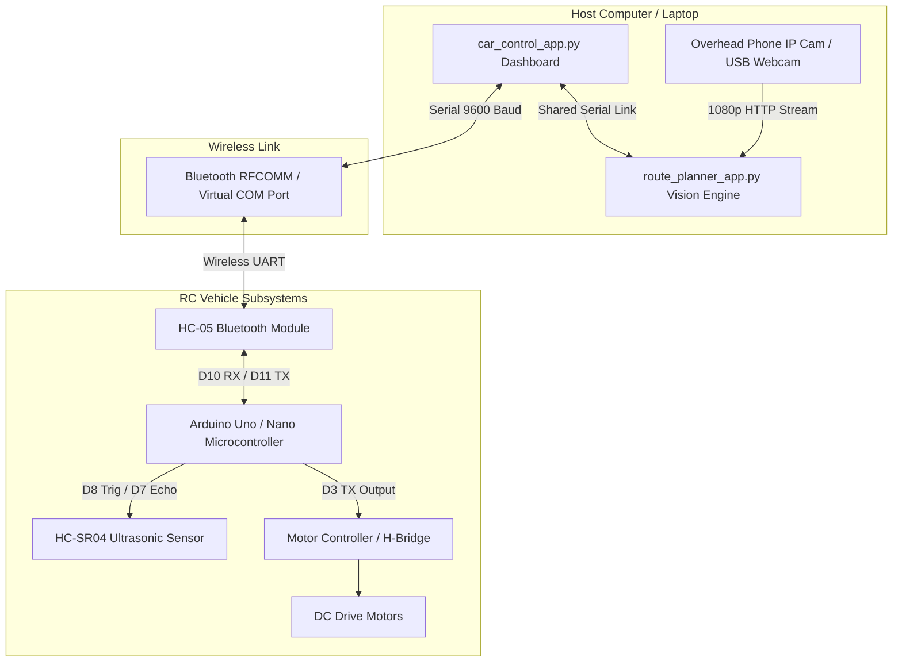
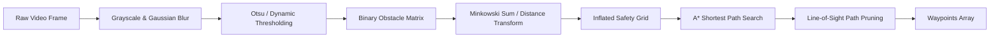
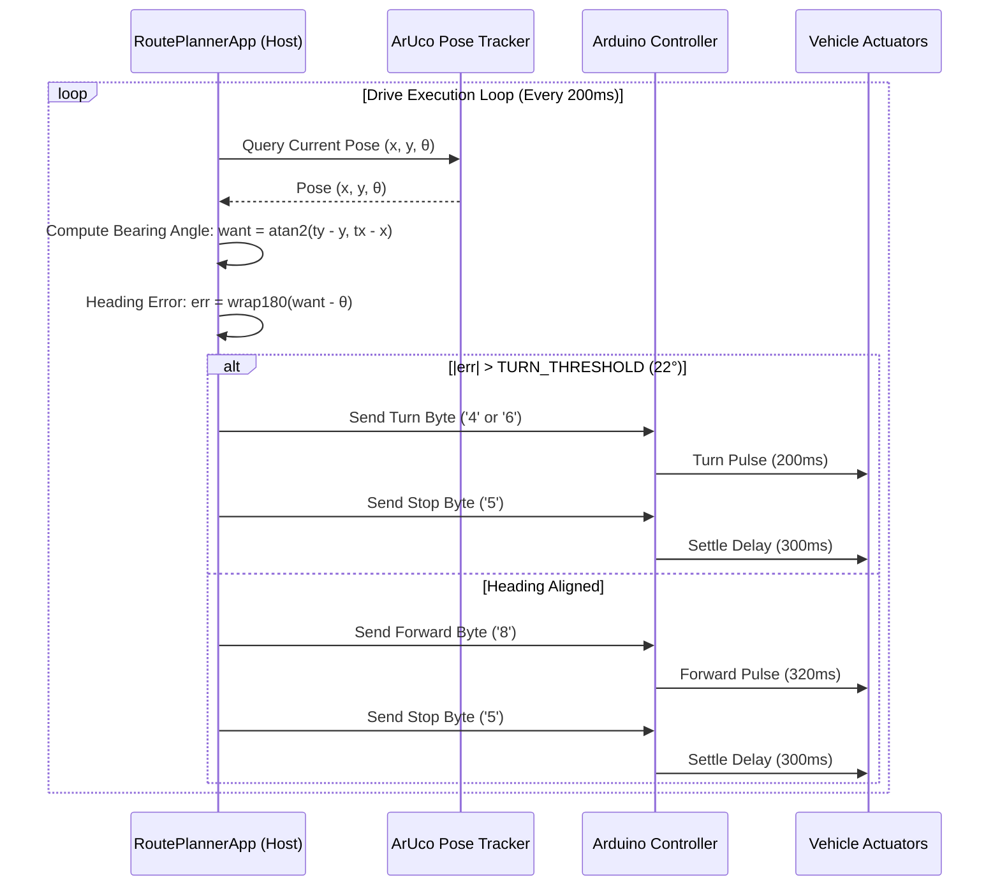

# Technical Specification & System Architecture Documentation

**Project Title:** Smart Autonomous RC Vehicle Navigation & Tri-Mode Guidance System  
**Repository:** `SKSUHASKANNADA/car-app-automation`  
**System Version:** 2.1 (Overhead 2-Marker Vision Guidance & Bluetooth HC-05 Bridge)

---

## 1. Executive Summary

This project implements a multi-layer autonomous robotic vehicle navigation platform that bridges high-level computer vision and discrete path planning with embedded motor actuators. The system operates in three distinct navigation modes:

1. **Manual Teleoperation Mode:** Low-latency keyboard/D-pad driving via Bluetooth serial.
2. **Auto Freeplay Mode:** On-board autonomous roaming using HC-SR04 ultrasonic range finding and obstacle reflection avoidance.
3. **Goal Maze Mode (Vision Autopilot):** Overhead camera-guided closed-loop path planning using OpenCV ArUco markers (Car ID `10`, Goal ID `20`), dynamic occupancy grid inflation, and the $A^*$ search algorithm.

The system requires no external cloud APIs or GPU compute; all telemetry, image processing, path simplification, and motion planning operate locally in real time at 30+ FPS.

---

## 2. Hardware Architecture & Pin Interconnects

The physical platform is powered by an Arduino microcontroller communicating with an HC-05 Bluetooth module, an L298N/similar motor driver board, and an HC-SR04 ultrasonic distance sensor.



### 2.1 Pin Assignment Matrix

| Peripheral / Module | Module Pin | Arduino Pin | Electrical Configuration | Description |
| :--- | :--- | :--- | :--- | :--- |
| **HC-05 Bluetooth** | `TXD` | `D10` | Direct software UART RX | Arduino receives commands from host. |
| **HC-05 Bluetooth** | `RXD` | `D11` | Voltage Divider ($1\text{ k}\Omega / 2\text{ k}\Omega$) | Level shift 5V Arduino TX to 3.3V HC-05 RX. |
| **HC-05 Bluetooth** | `VCC` / `GND` | `5V` / `GND` | Decoupled Power Rail | Module supply voltage. |
| **HC-SR04 Ultrasonic**| `Trig` | `D8` | Digital Output | 10 $\mu\text{s}$ trigger pulse emitter. |
| **HC-SR04 Ultrasonic**| `Echo` | `D7` | Digital Input | Pulse width timing receiver ($d = \frac{t}{58}\text{ cm}$). |
| **Motor Board Link** | Input / Signal| `D3` | Digital Serial TX | Forwards verified drive bytes to motor bridge. |
| **Motor Board Link** | Dummy RX | `D4` | Unconnected | Placeholder required by `SoftwareSerial`. |

---

## 3. Communication Protocol Specification

Communication between the host application and the vehicle controller utilizes an ASCII single-character streaming protocol over Bluetooth RFCOMM (UART emulation at 9600 baud, 8 data bits, no parity, 1 stop bit).

### 3.1 Command Opcode Table

| Opcode (ASCII) | Direction | Command Name | Functional Action |
| :---: | :---: | :--- | :--- |
| `'8'` | Host $\rightarrow$ Car | `CMD_FWD` | Engages forward motor drive. |
| `'2'` | Host $\rightarrow$ Car | `CMD_BACK` | Engages reverse motor drive. |
| `'4'` | Host $\rightarrow$ Car | `CMD_LEFT` | Engages left steering / skid turn counter-clockwise. |
| `'6'` | Host $\rightarrow$ Car | `CMD_RIGHT` | Engages right steering / skid turn clockwise. |
| `'5'` | Host $\rightarrow$ Car | `CMD_STOP` | De-energizes all drive outputs immediately. |
| `'A'` | Host $\rightarrow$ Car | `MODE_AUTO` | Switches microcontroller to internal autonomous obstacle avoidance. |
| `'M'` | Host $\rightarrow$ Car | `MODE_MANUAL` | Cancels auto routines; transitions to manual teleoperation. |
| `'R'` | Host $\rightarrow$ Car | `MODE_ROUTE` | Enables route execution guard with ultrasonic emergency braking. |

---

## 4. Computer Vision & Pose Estimation Pipeline

The vision system in `route_planner_app.py` computes millimeter-accurate coordinate transformations and headings using OpenCV ArUco synthetic planar markers.

### 4.1 Marker Geometry & Identification
- **Dictionary:** `cv2.aruco.DICT_4X4_50`
- **Car Marker (ID 10):** Rigidly mounted flat on the car chassis roof.
- **Goal Marker (ID 20):** Placed flat on the arena floor at the destination waypoint.

### 4.2 Heading ($\theta$) & Centroid Calculation
Given the four detected corner coordinates $C = [p_0, p_1, p_2, p_3]$ where $p_i = (x_i, y_i)$:
1. **Centroid $(c_x, c_y)$:**
   $$c_x = \frac{1}{4} \sum_{i=0}^{3} x_i, \quad c_y = \frac{1}{4} \sum_{i=0}^{3} y_i$$
2. **Forward Heading Vector $(dx, dy)$:**
   The top edge of an ArUco marker is formed by the midpoint of corner 0 and corner 1:
   $$t_x = \frac{x_0 + x_1}{2}, \quad t_y = \frac{y_0 + y_1}{2}$$
   $$dx = t_x - c_x, \quad dy = t_y - c_y$$
3. **Angular Heading Angle $\theta$:**
   $$\theta = \text{atan2}(dy, dx) \times \frac{180}{\pi}$$
   Normalized to $(-180^\circ, +180^\circ]$ via wrapping function:
   $$\text{wrap180}(\alpha) = (\alpha + 180) \pmod{360} - 180$$

---

## 5. Path Planning & Obstacle Inflation ($A^*$)

Navigation across structured or unstructured obstacle fields utilizes discrete space decomposition and the $A^*$ heuristic search algorithm.



### 5.1 Obstacle Inflation (Clearance Guarantee)
To guarantee the vehicle's physical chassis does not scrape walls or maze edges, obstacle pixels are inflated using the vehicle's diagonal bounding radius:
- **Vehicle Dimensions:** Length $L = 18\text{ cm}$, Width $W = 22\text{ cm}$, Height $H = 12\text{ cm}$.
- **Half-Diagonal Inscribed Radius ($R_\text{car}$):**
  $$R_\text{car} = \sqrt{\left(\frac{L}{2}\right)^2 + \left(\frac{W}{2}\right)^2} = \sqrt{9^2 + 11^2} = \sqrt{202} \approx 14.21\text{ cm}$$
- **Total Safety Radius ($R_\text{total}$):**
  $$R_\text{total} = R_\text{car} + \text{Margin}_\text{safety} = 14.0\text{ cm} + 4.0\text{ cm} = 18.0\text{ cm}$$

In the occupancy grid (cell size $c = 4\text{ cm}$), binary dilation expands every detected wall by $k = \lceil R_\text{total} / c \rceil$ cells.

### 5.2 $A^*$ Heuristic Evaluation Function
Path exploration minimizes the standard cost function:
$$f(n) = g(n) + h(n)$$
where $g(n)$ is the exact Euclidean path distance from the car start node to node $n$, and $h(n)$ is the Euclidean distance heuristic to the goal:
$$h(n) = \sqrt{(x_g - x_n)^2 + (y_g - y_n)^2}$$

### 5.3 Line-of-Sight Path Simplification
Raw grid paths produce zigzag stair-step artifacts. A ray-casting line-of-sight (Bresenham) filter checks visibility between non-adjacent nodes $[w_i, w_{i+k}]$:
- If no inflated obstacle intersects the segment $\overline{w_i w_{i+k}}$, intermediate cells are pruned.
- The resulting trajectory consists of smooth, direct waypoints with minimal turns.

---

## 6. Closed-Loop Steering & Execution Controller

Driving is governed by an iterative **Proportional-Heading Pulse Controller** running at 5 Hz:



### 6.1 State Verification & Error Tolerance
- **Heading Deadband ($\epsilon_\theta$):** $\pm 22.0^\circ$ — prevents continuous hunting and oscillations.
- **Waypoint Proximity Tolerance ($d_\text{tol}$):** $10.0\text{ cm}$ ($12.0\text{ cm}$ for destination goal).
- **Stale Marker Timeout ($t_\text{lost}$):** $2.0\text{ s}$ — halts vehicle if line-of-sight to the overhead camera is blocked.

---

## 7. Software Architecture & File Inventory

| File Path | Functional Responsibility |
| :--- | :--- |
| **`car_control_app.py`** | Main application window, Tkinter modern dashboard, Bluetooth port scanning, serial manager background thread, D-pad control, and mode switching. |
| **`route_planner_app.py`** | Vision processing engine, IP webcam stream handler, ArUco tracker, occupancy map, $A^*$ path planning, and closed-loop steering loop. |
| **`car_bridge.ino`** | Microcontroller firmware for manual teleoperation and autonomous ultrasonic roam. |
| **`car_bridge_route.ino`**| Microcontroller firmware adding guarded route navigation with active ultrasonic emergency braking. |
| **`run_app.bat`** | Windows launcher shortcut executing Python environment directly in active GUI context. |
| **`requirements.txt`** | Dependency manifest (`pyserial`, `opencv-contrib-python`, `numpy`, `pillow`). |
| **`markers/`** | Generated printable ArUco markers: `marker_10.png` (Car) and `marker_20.png` (Goal). |

---

## 8. Deployment & Operational Runbook

### Step 1: Environment Setup
Ensure Python 3.10+ is installed and install the required modules:
```powershell
pip install -r requirements.txt
```

### Step 2: Physical Marker Placement
1. Print `markers/marker_10.png` and `markers/marker_20.png` on matte paper (do not cut into the white margin).
2. Affix **Marker 10** flat on the top of the vehicle chassis, ensuring the **top edge points toward the front bumper**.
3. Place **Marker 20** flat at the desired destination.

### Step 3: Application Launch & Connection
1. Launch the dashboard by running:
   ```powershell
   python car_control_app.py
   ```
2. Select your paired **HC-05 COM port** (e.g. `COM4`) and click **Connect**.
3. Verify basic motor operation by clicking or holding **F** / **B** / **L** / **R**.

### Step 4: Autonomous Vision Navigation
1. Click **🎯 OPEN GOAL MAZE MODE** to spawn the Vision Autopilot.
2. Under **1. Camera / Map Picture**, enter your camera stream URL (e.g. `http://192.168.137.21:8080/video`) and click **Connect Cam**.
3. Under **2. Obstacles**, click **Auto Detect** or paint extra barriers using Left-Click drag.
4. Click **Plan A\* Route**. Verify that the green trajectory cleanly avoids all red clearance zones.
5. Click **▶ START DRIVE** to execute autonomous closed-loop guidance!
